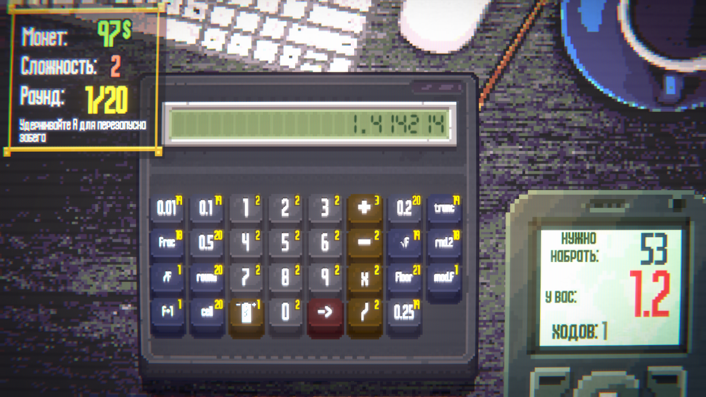

# Fractional Numbers 0.7.1

Первый отдельный мод для Calculate It. Требует [Calculate It Mod Loader 1.3.0 или новее](https://github.com/Full-Time-Krist/calculate-it-mod-loader) и BepInEx 5. Добавляет 45 кнопок в обычный магазин и случайные награды, 4 пассивки и отдельный дробный калькулятор.

В меню **Моды → Fractional Numbers** доступна коллекция всех 45 кнопок и 4 пассивок на оригинальном экране коллекции игры: блокнот, сетка клавиш, родные стрелки и всплывающие описания при наведении. Коллекция доступна сразу, без начала забега, на обоих языках игры. Архив версии 0.7.1 также содержит DLL загрузчика 1.3.0.



| Кнопка | Действие |
| --- | --- |
| `0.1` | Ввести одну десятую |
| `0.2` | Ввести две десятых |
| `0.5` | Ввести половину |
| `√f` | Квадратный корень с дробной частью: `√f(2) = 1.414214` |
| `round` | До ближайшего целого; половины от нуля: `−2.5 → −3` |
| `floor` | Вниз: `2.7 → 2`, `−2.7 → −3` |
| `ceil` | Вверх: `2.1 → 3`, `−2.7 → −2` |
| `0.25` | Ввести четверть |
| `0.01` | Ввести одну сотую |
| `trunc` | Целая часть к нулю: `−2.7 → −2` |
| `frac` | Дробная часть со знаком: `−2.7 → −0.7` |
| `rnd.2` | До сотых, половины от нуля: `1.235 → 1.24`, `−1.235 → −1.24` |

В версии 0.2.0 добавлены `0.25`, `0.01`, `trunc`, `frac`, `rnd.2`. Обозначение `rnd.2` означает `round₂`. Идентификаторы и ключи первых семи кнопок сохранены; новые добавлены в конец реестра. После загрузки сохранения расширяется массив статистики, если он остался короче нового набора.

Дробная числовая кнопка вводит отдельное значение, заменяя вводимый операнд. Например, после выбора `+` нажатие `0.2` выбирает число `0.2`. Обычные цифры могут продолжить ввод: `0.1`, затем `2` дают `0.12`.

Оригинальный корень сохраняет фактическое поведение установленной игры: округление до ближайшего целого (`√8 = 3`). Новая кнопка `√f` существует отдельно. Оригинальная кнопка округления до десятков тоже не заменяется.

## Расширение 0.3.0

Добавлено ещё 33 кнопки, всего 45. Идентификаторы прежних 12 кнопок не менялись.

| Семейство | Подпись | Правило |
| --- | --- | --- |
| Ввод десятых | `0.1`…`0.9` | Весь набор из девяти значений; введение операнда |
| Прибавление | `+0.1`…`+0.9` | Немедленно прибавляет к текущему значению |
| Вычитание | `−0.1`…`−0.9` | Немедленно вычитает из текущего значения |
| Дробное деление | `/f` | Выбор делителя; `5 /f 2 = 2.5` даже при целых исходных числах |
| Дробный остаток | `mod.f` | Выбор делителя; `5.5 mod.f 2.2 = 1.1` |
| Деление пополам | `/2` | Немедленно делит текущее число на 2 |
| Деление на четыре | `/4` | Немедленно делит текущее число на 4 |
| Перестановка | `swap.f` | `12.345 → 345.12`; `12.03 → 3.12`; знак сохраняется |
| Случайная дробь | `rand.f` | Меняет только дробную часть; сохраняет видимое число разрядов. У целого числа появляется один дробный разряд |
| Последний разряд +1 | `f+1` | `1.29 → 1.3`; `1.2 → 1.3` |
| Последний разряд −1 | `f−1` | `1.21 → 1.2`; `1.2 → 1.1` |
| Удаление последней цифры | `cut.f` | `1.29 → 1.2`; `1.2 → 1` |

Нули в конце дроби не сохраняются: следующая операция использует последнюю **видимую** цифру. Для отрицательных чисел редактируется модуль с сохранением знака: `f+1(−1.29) = −1.3`. Если дробной части нет, `f+1`, `f−1` и `cut.f` показывают подсказку и не расходуют заряд. `trunc` удаляет дробную часть целиком, как и раньше.

Остаток имеет знак делимого: `−5.5 mod.f 2.2 = −1.1`. Случайная дробь использует генератор Unity, состояние которого сохраняет игра. Отмена `/f` и `mod.f` возвращает заряд именно выбранной кнопке; её ключ сохраняется вместе с ожидающей операцией.

Игровая вместимость калькулятора не увеличивается: 45 — это каталог доступных кнопок, а не размер стартового набора.

## Вычисления

После ввода дроби или использования новой операции калькулятор переходит к дробным вычислениям. Поддержаны обычные `+`, `−`, `×`, `/`, остаток, проценты, квадрат и числовые модификаторы. Вне этого режима исходные целочисленные операции выполняются игрой как прежде. Новый раунд сбрасывает режим.

Числа вычисляются через `decimal`, с округлением до шести знаков после каждой операции и игровым пределом по модулю 999999. Отображение использует точку и убирает лишние нули. Дробный результат сохраняется при отправке на табло и не может победить целую цель путём отбрасывания дробной части. Цели остаются целыми; штатные допуски специальных режимов и пассивки близости учитываются.

Унарная операция завершает уже введенную бинарную операцию: `0.1 + 0.2`, затем `ceil` дают `1`. Деление на ноль, корень из отрицательного числа и операция без второго операнда не меняют состояние и не расходуют заряд.

Кнопки, работающие с целочисленными цифрами или битами, требуют сначала завершить операцию и округлить дробное число. При попытке использовать их на дроби выводится подсказка; число и заряд сохраняются.

## Сохранения

Точные значения и ожидающая операция записываются штатным механизмом сохранений вместе с новыми кнопками. Например, незавершённое `0.1 + 0.2` восстанавливается без потери дробной части.

Для продолжения забега, сохранённого с этим модом, мод должен оставаться установленным. Перед удалением закончите такой забег. Игровые DLL не заменяются.

## Сборка и установка

Из корня репозитория:

```powershell
dotnet build .\FractionalNumbers.csproj -c Release
powershell -ExecutionPolicy Bypass -File .\Install.ps1
```

Сначала установите игру, BepInEx и загрузчик версии 1.3.0 или новее. Сборка берёт игровые DLL, BepInEx и сборку загрузчика из установленной игры; исходники соседнего репозитория не требуются. Для другого расположения игры передайте `-p:GameRoot="D:/Steam/steamapps/common/Calculate It"`. Пути можно также задать отдельно свойствами `GameManaged`, `BepInExCore` и `ModLoaderAssembly`. Сторонние DLL и файлы игры не включены в репозиторий.

Либо скопируйте папку `BepInEx` из архива мода в папку игры при установленном загрузчике. Для обновления с 0.1.0 или 0.2.0 заменяется та же DLL. После перезапуска в меню «Моды» появится **Fractional Numbers 0.3.0**. Новые кнопки можно встретить в магазинах; автоматически на калькулятор они не добавляются.

## Проверка

```powershell
dotnet run --project .\tests\FractionalNumbers.Tests.csproj -c Release
```

137 проверок арифметики, округления, последовательности операций, неизменности состояния при ошибках и распределения/достижимости дробных целей. [Проверочный плагин](./verification/Integration.cs) дополнительно проверяет в самой игре регистрацию 45 кнопок, нажатия пяти новых кнопок, два разных корня, единичное списание заряда, смешанный ввод, отмену, магазин и покупку, точную отправку результата, сохранение и загрузку с сохранением зарядов. Проверяется и восстановление массива статистики длины версии 0.1.0.

Проверочный плагин предназначен только для тестового запуска с резервной копией сохранений. Он изменяет тестовый забег и закрывает игру после проверки. В обычную установку и архив не включается. Для запуска задаётся `CALCULATEIT_VERIFY_OUTPUT` с папкой отчёта.

Все сочетания с пассивками, боссами и вариантами калькуляторов пока не проверены.

## Пассивки 0.4.0

Четыре пассивки появляются в обычном выборе пассивок и занимают стандартные слоты:

- **Мелочь**: +1 монета за каждую видимую дробную цифру принятого ответа, без конечных нулей.
- **Почти целое**: целая часть ответа должна совпасть с целью; усечение к нулю.
- **Счастливый разряд**: цифра 1–9 выбирается в начале раунда. Совпадение с последней дробной цифрой принятого ответа даёт +5 монет.
- **Запас точности**: дробная победа добавляет 1 заряд случайной установленной кнопке этого мода.

Эффекты складываются и начисляются один раз за раунд. Цифра и отметка награды сохраняются при загрузке. Денежные награды соблюдают ограничения испытаний на доход в конце раунда.

## Дробный калькулятор 0.5.0

В конце стандартного списка калькуляторов доступен «Дробный калькулятор» (Fractional Calculator), сразу без разблокировки. Выбор открывает обычный экран сложности; прогресс сложности хранится отдельно от исходных калькуляторов. Стартовый размер — 4 × 4:

| | | | |
|---|---|---|---|
| 0.1 | 0.2 | 0.3 | round |
| 0.4 | 0.5 | 0.6 | ceil |
| 0.7 | 0.8 | 0.9 | √f |
| trunc | 0.25 | → | /f |

Стрелка отправляет ответ стандартным способом. Магазины и четыре пассивки доступны по обычным правилам. Набор начальных кнопок задаётся отдельно; исходные калькуляторы сохраняют свои наборы. Корпус использует родные игровые спрайты и выбранный скин.

Выбранный калькулятор, кнопки, заряды и незавершённые дробные операции сохраняются штатной системой продолжения забега. Проверка [CalculatorIntegration.cs](./verification/CalculatorIntegration.cs) проходит через экран выбора, новый забег, корень, сохранение/загрузку без дублирования кнопок и завершение раунда обычной стрелкой. Для этого режима проверочного плагина дополнительно задаётся `CALCULATEIT_VERIFY_CALCULATOR=1`.


## Баланс и дробные цели 0.6.0

В новом забеге дробного калькулятора trunc, /f и √f начинают с 10 использований. Загрузка сохраняет оставшиеся заряды.

В обычном режиме этого калькулятора цели распределяются с вероятностями 80% между 0 и 1, 15% с ненулевой целой и дробной частями, 5% целых. Таблицы целей составлены из значений, достижимых стартовыми кнопками: вводом десятых или делением двух десятых. Цель хранится с точностью до шести знаков; победа проверяется по точному значению. Сохраняются текущая цель и заранее показанная следующая цель. Переброс цели и переход к следующему раунду используют ту же генерацию.

Оригинальные калькуляторы, обучение и испытания сохраняют штатную генерацию. Явная нулевая цель босса и целочисленное правило пассивки Метроном сохраняются. Старые сохранения без точной цели сохраняют прежнюю целую цель до её следующей смены.
